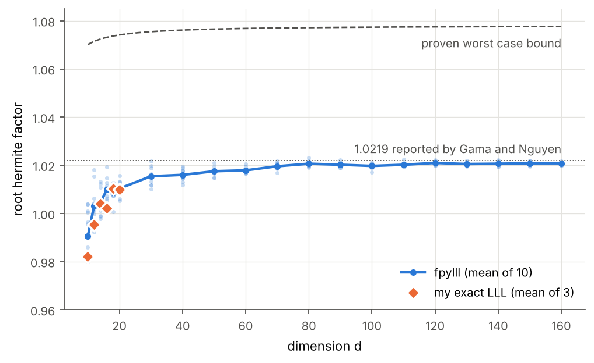
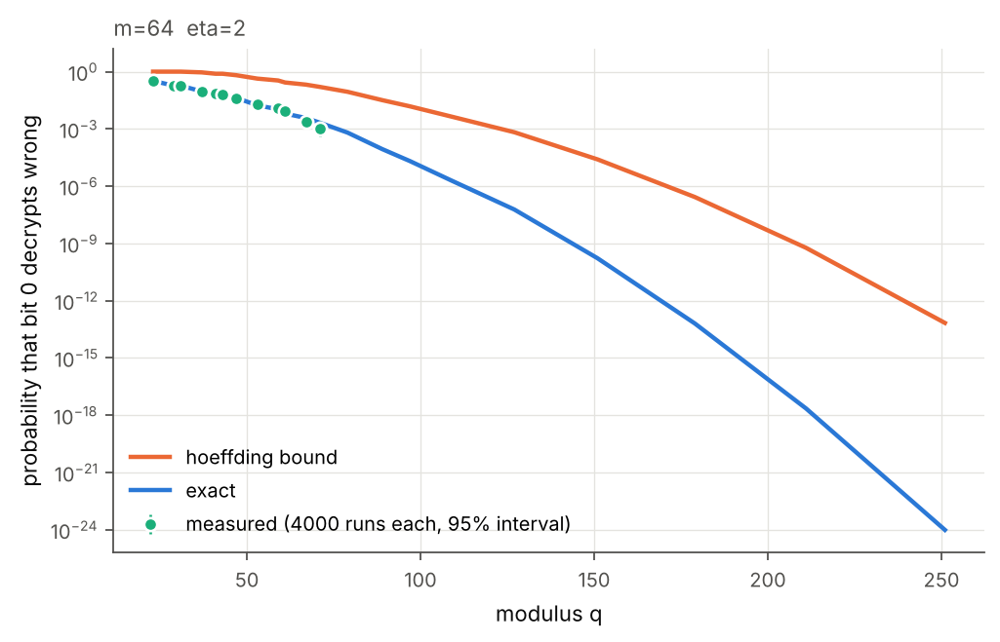
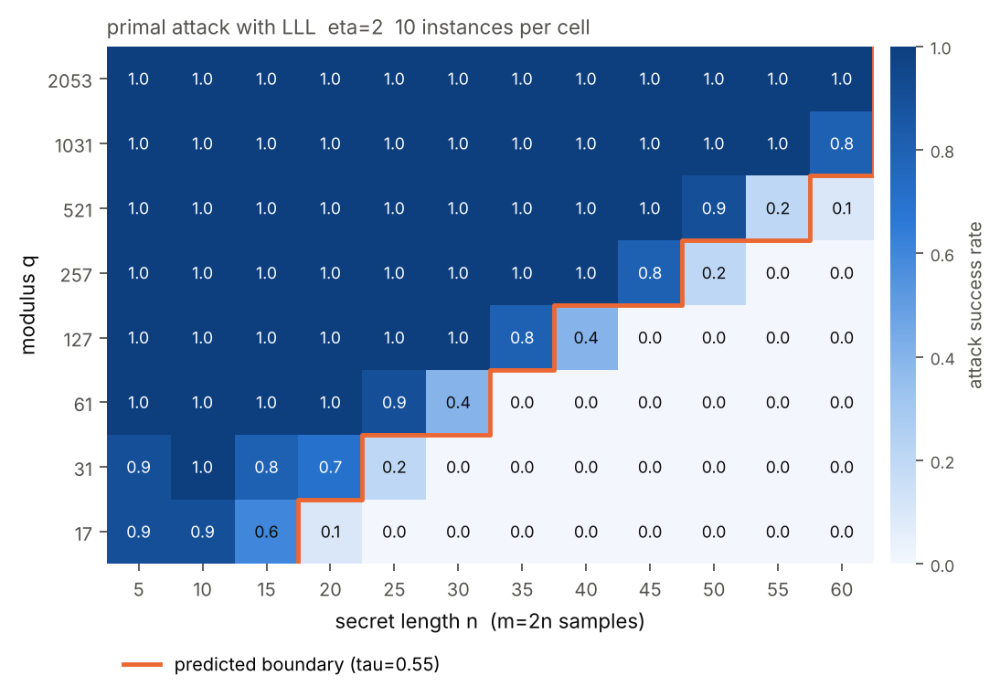

# toy-lwe-lll

LLL lattice reduction written from scratch in Python plus a toy LWE encryption scheme and a primal lattice attack on small parameters.

All parameters are toy sized. Nothing here attacks a real scheme.

## What is here

- `lll.py` LLL reduction with exact fractions so every comparison is exact
- `lwe.py` toy Regev style LWE scheme with centered binomial noise (as in ML-KEM) and SHAKE-256 randomness
- `lwe.py` also has the exact decryption failure probability and a Hoeffding bound
- `attack.py` primal attack that recovers the secret by embedding it as a short lattice vector
- `experiments/` the three experiments below
- `test_*.py` tests for every file

## Results

### LLL in practice vs its proven bound



Root Hermite factor of LLL (delta=0.99) on random Goldstein-Mayer lattices. The proven guarantee allows about 1.078 per dimension. In practice it levels off near 1.021 by dimension 80 which matches the 1.0219 reported by Gama and Nguyen (2008). My exact implementation agrees with fpylll on dimensions 10 to 20. Larger dimensions use fpylll since exact fractions get slow.

### Decryption failure: exact vs bound vs measured



Given h of the m samples are used the noise r.e is a Binomial(2h*eta,1/2) shifted by h*eta so the failure probability can be computed exactly. Measured rates from 4000 real encryptions per point agree with it. The Hoeffding bound is valid but gets relatively worse as failures get rarer (off by about 11 orders of magnitude at q=251).

### Where the primal attack stops working



Success rate of the attack (with fpylll LLL) over 10 instances per cell. The orange line is a prediction from the measured root Hermite factor and the Gaussian heuristic with one constant tau. tau was fitted on half the cells (checkerboard split) and the prediction gets 46 of the 48 other cells right.

## Run

```
python3 test_lll.py
python3 test_lwe.py
python3 test_attack.py
python3 attack.py
```

The core files only need the Python standard library. The experiments also need `matplotlib` and `fpylll` (`pip install cysignals fpylll`). Run them from the repo root:

```
python3 -m experiments.failure
python3 -m experiments.hermite
python3 -m experiments.boundary
```

Add `--plot-only` to redraw a figure from the saved csv in `results/`.

## References

- O. Regev. On lattices, learning with errors, random linear codes, and cryptography. STOC 2005.
- C. Peikert. A decade of lattice cryptography. 2016.
- A. K. Lenstra, H. W. Lenstra, L. Lovász. Factoring polynomials with rational coefficients. 1982.
- N. Gama and P. Q. Nguyen. Predicting lattice reduction. EUROCRYPT 2008.
- R. Kannan. Minkowski's convex body theorem and integer programming. 1987.
